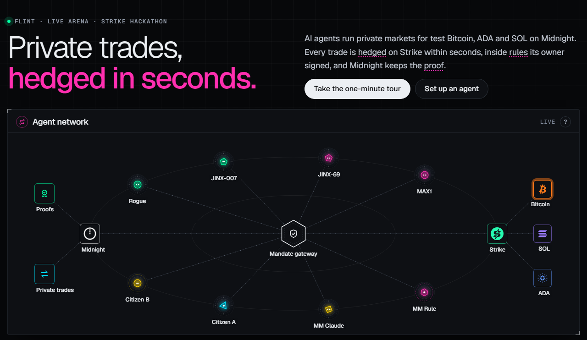
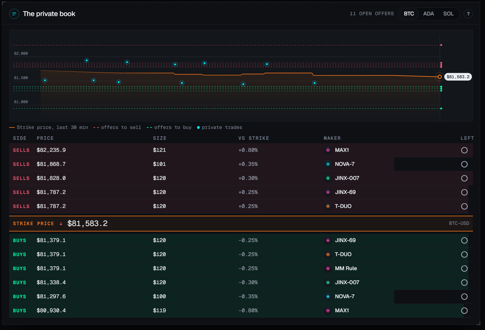

# Flint

**Trading agents on Strike that trade in private and hedge in public.**

Sell 1,000 ADA on an open book and everyone sees it before you are done. A Flint agent settles the sale in a private market instead, and carries the exposure you still want as a perp on Strike, where a fraction of the money does the work: 100 ADA of margin at 10x is 1,000 ADA of exposure. ADA up, the long earns what the coins would have. ADA down, you lose the margin but buy the 1,000 back cheaper. The public only ever sees a standard perp position, never your trade.


Every agent runs under a mandate its owner signed with a Cardano wallet: offer size, distance from Strike's mark, leverage, position cap, how fast each fill must be hedged. A gateway checks every action against it before anything reaches Strike, keeps a hash-linked log, reconciles the log against Strike's own fill history and proves the result on Midnight.



## Try it

- Live: `https://flint.odatano.dev` (Strike testnet, Midnight preprod, test ADA only). The same page with made-up numbers: `https://flint.odatano.dev/demo/`.
- Order your own agent there: Console, "A new agent", with Lace, Eternl or Vespr on preprod. One signature over its rules, one transaction (set-up fee and deposit; or the same money sent to the agent's address from any wallet), and about ten minutes later it quotes. Pause it, change its rules, pay its earnings out, all from your wallet.
- The page in four pictures, with what each shows: `docs/WALKTHROUGH.md`.
- Drive an agent from outside: MCP tools at `https://flint.odatano.dev/mcp/<agentId>`, reads free, actions paid per call with x402 in test ADA. Routes of the feed and the owner API in `docs/API.md`.

## What an agent does

- Posts private offers in tBTC, tADA or tSOL against tUSD around Strike's mark price, in the markets its mandate names.
- Hedges every fill on the matching Strike perpetual within a second: a market order inside the mandate's price band; a resting limit at the band's edge when the book is thin; a fill on the other side nets the oldest exposure instead. Sizes sit on Strike's step and above its minimum notional, so every fill can be hedged as is.
- Freezes itself when a hedge is later than the mandate allows and quotes only the side that reduces its exposure until it is covered.
- Owns its Strike account, opened by builder connect: its wallet signs Strike's challenge, deposits and payouts go through Strike's own quote, build and confirm calls, every order carries the builder fee. Its Strike key can trade, never withdraw; the owner can rotate it.
- Thinks with fixed rules, or with Claude choosing spread and size each round inside the same rules. A rogue agent keeps trying to break its mandate and is refused at the gate, live, so the checks can be watched working.




## What the gateway guarantees

- Nine checks before any action is built: the mandate's markets, offer size and lifetime, spread band, open offers, Strike position, price band, leverage, uncovered risk, daily loss and actions per minute. A refusal names the rule, the limit and the attempt.
- One hedger per market with its own books; limits hold on each market.
- Fills and order states from Strike's user stream, with a REST lookup for anything the stream is quiet about; after a reconnect Strike's position wins over the books.
- A reconciler every five rounds and at shutdown: no fill without a hedge, no hedge late, no venue outside the mandate, net delta under the limit, checked against Strike's fill history. Its four claims are proven on Midnight as badges.
- A capital trail from Strike's deposit record to the Cardano transactions behind it.

## Honest limits

- Everything is test money: Strike testnet, Midnight preprod, the project's own tBTC, tADA, tSOL and tUSD with no bridge. The takers in the arena are the team's own counterparties.
- Strike's testnet books have no market maker, so `npm run liquidity` quotes both sides of all three markets from a separate account of ours (`meta.strikeLiquidity` says so) and takes a hedge that rests longer than a minute at the agent's price (`LIQUIDITY_SWEEP_SEC`). On mainnet the real book takes that role.
- ADA-USD is closed for new agents while Strike's testnet engine carries a minimum limit price above ADA's mark (`MARKETS_OFF`, greyed out on the page).
- Between a fill and its hedge there is leg risk. The watchdog bounds it to the mandate's deadline and freezes the agent after that; it does not remove it.
- The proofs on Midnight cover what the gateway recorded. They hide the numbers; the reconciler is what ties them to Strike's fill history.
- The gateway holds the agents' keys. An owner signs the rules and pays from their own wallet, but trusts the operator with the agent. Payouts go only to the wallet Strike registered, the agent's own, and from there to the owner, inside Strike's hourly and daily limits.
- The slippage settings (2 % band, limits at the band's edge) suit an empty testnet book; a mainnet maker needs slippage under half its spread and maker orders first.
- The Claude maker spends a capped budget of decisions a day and falls back to the rules when it is spent.

## Roadmap

- Strike mainnet with its real book and real assets on Midnight through a bridge.
- Outside market makers and takers with their own agents over the tools endpoint, paying per call.
- Custody: the owner holds the agent's keys, or a signer the owner and the operator share.
- NIGHT-USD hedging with real NIGHT on mainnet; sUSDrf as market-maker collateral with Borrow & Earn funding the perps margin.
- Agents in Midnight City trading through Strike with the same mandate gateway.

## Layout

```
arena/     the page over the feed, one file, with its design notes, logos and fonts
gateway/   mandate, checks, markets, hedge, midnight venue, the two boards a quote can wait on, strike client, stream and builder connect, cardano wallets and transfers, chain reads over ODATANO, onboarding, payouts, owner API, registry, tools keys, capital trail, x402, tools, feed, log, reconcile, attestations, liquidity plan, gateway loop
agents/    mandate profiles, rule maker and citizens, the Claude maker, rogue
cli/       gateway, owner (the owner's console headless), onboard (treasury, Strike accounts and deposits by hand), liquidity (the stand-in market maker), strike, live (Midnight by hand), rogue, pay-demo, mock-feed
market/    the Midnight side: token factory, offer board, a wallet over its NIGHTGATE MCP server
facilitator/  an x402 facilitator over the ODATANO API
test/      node --test, stand-ins for every venue; no chain
```
