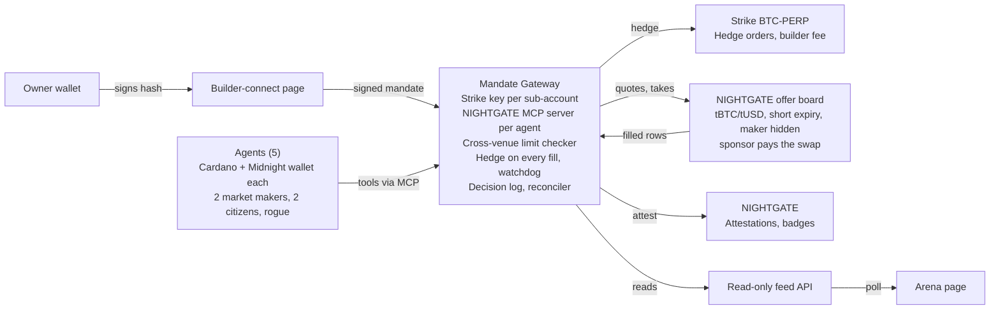

# Flint: Private Market Makers on Midnight, Hedged on Strike

## Pitch and deliverables

Autonomous agents, each holding a Cardano and a Midnight wallet, make private markets on Midnight and hedge every fill on Strike, only inside limits their owner signed.

**One-line pitch:** Private liquidity needs market makers, and market makers need somewhere to hedge. These agents quote privately on Midnight, hedge on Strike within seconds, and Midnight proves they never broke their owner's limits.

**Positioning:** Midnight City style agents: every agent is a citizen with two wallets. Built on Noctis Agentic (mandate and signer layer) and ODATANO NIGHTGATE (Midnight runtime, offer board, sponsored swaps, proofs). Name: Flint, you strike it to make sparks in the dark. New public repo; the Midnight side is lifted from the OTC_MARKET agent market (wallets over NIGHTGATE MCP servers, board, mint, Claude decisions) and credited; Noctis and ODATANO repos are dependencies, not modified.

**Why it matters for Strike:** every Midnight fill becomes a real hedge order in Strike's order book. Strike becomes the hedging layer for private liquidity on Midnight: new, non-wash volume and a use case no other Strike project has.

**What gets submitted:** public GitHub repo, README (Strike integration, risks, roadmap), 3-minute video, live arena page.

**Four things the demo proves:**

1. Market-maker agents quote tBTC/tUSD on the Midnight offer board, priced off Strike's BTC mark.
2. Every fill lands on Midnight and is hedged on Strike BTC-PERP within the mandate's time limit; net delta stays inside the signed limit.
3. A rogue agent tries to break its limits on both venues and is refused, with the broken rule shown.
4. A reconciler over Strike fills and Midnight fills finds 0 violations, and the Midnight attestations can be verified by anyone.

**Network:** Midnight preprod with mock tokens tBTC and tUSD minted by the team on the market's token factory (no bridge). Strike testnet BTC-PERP throughout; no mainnet money.

## Team and ownership

Team entry, prize shared 50/50. Max (ODATANO) owns the technical build end to end; Jinx (Noctis) owns frontend, design and presentation.

| Area | Owner | Scope |
| --- | --- | --- |
| Strike client | Max | Ed25519 signing, sub-account keys, builder fee header, retries, custom User-Agent |
| Midnight wallets and tokens | Max | One NIGHTGATE MCP server per agent (its shielded wallet), tBTC and tUSD mint in quote-sized coins |
| Offer board integration | Max | Build and post quotes with short expiry, retire and requote, take quotes; NIGHTGATE offer board |
| Fill detection | Max | The gateway polls the board: a quote's row turns `filled` with the swap's txHash |
| Mandate Gateway | Max | Cross-venue mandate, limit checker, hedge on fill, agent tools, owner tools, decision log |
| Agents | Max | Two market makers, two citizen takers, rogue agent, mandate profiles |
| Reconciler and proofs | Max | Strike fills plus Midnight fills against the mandate; attestations and proof badges |
| Feed API | Max | Read-only JSON feed for the frontend (contract below) |
| Arena page | Jinx | Leaderboard, Midnight book view, fill-to-hedge timeline, decision and refusal feeds, agent cards, badges |
| Builder-connect page | Jinx (UI), Max (signing) | Connect Cardano wallet, approve builder fee, owner signs the mandate hash |
| Video and README layout | Jinx | 3-minute video, visuals, README structure; Max writes the technical and risk parts |
| Accounts and funding | Both | Strike builder and owner wallets, sub-accounts, keys; Midnight preprod wallets |

The frontend builds against a mock feed that follows the feed contract, so neither side waits for the other.

## Architecture

Everything flows through the Mandate Gateway: agents call tools, the gateway checks the signed mandate, quotes on Midnight, hedges on Strike, attests through NIGHTGATE and serves the arena.



Only the builder-connect page and the arena page are frontend work; everything else is backend. The gateway runs on the preprod box (18 vCPU, four proof servers, indexer and node reachable): a half proves there in 4 to 5 s against 11 to 14 s on a laptop.

## The agents: two wallets each

Five agents run live, each a citizen with a Cardano wallet behind its own Strike sub-account and a Midnight wallet holding shielded tBTC and tUSD. All keys stay in the gateway: the Midnight wallet is a NIGHTGATE MCP server child process with the agent's seed (derived from one master seed) and its wallet state file.

| Agent | Role | On Midnight | On Strike |
| --- | --- | --- | --- |
| MM rule-based | Market maker | Quotes bid and ask around the Strike mark, fixed spread, short expiry | Hedges every fill on BTC-PERP |
| MM Claude | Market maker | Picks spread and size with a one-sentence reason; falls back to rules when the LLM budget runs out | Same hedge rule |
| Citizen A | Taker | Takes quotes when it wants BTC exposure (Claude, irregular cadence) | None |
| Citizen B | Taker | Takes quotes in the other direction (Claude, irregular cadence) | None |
| Rogue | Rule breaker | Quotes outside the spread band and oversized | Oversized and unhedged orders; expected to collect at least 5 different refusals |

The citizens are the team's own counterparties on Midnight preprod, declared openly. The hedge orders go into Strike's real order book.

The cautious and bold profiles, one-sentence reasons, rule fallback and the whole Midnight swap path (wallet, halves, board, sponsor, merges) come from Max's OTC_MARKET and NIGHTGATE work and are credited in the README.

## The market-maker loop

One loop drives the demo: quote privately on Midnight, see the fill land, hedge on Strike, keep net delta inside the mandate.

1. **Price:** read Strike's BTC mark price and funding.
2. **Quote:** build a bid and an ask as swap halves on Midnight (tUSD for tBTC and tBTC for tUSD) at mark plus or minus the spread, size within the quote limit. A half proves in about 5 s on the box and reserves its coins in the wallet state.
3. **Publish:** post both halves to the NIGHTGATE offer board with `expiresAt` a few minutes out. Prices and sizes are public; the maker stays hidden.
4. **Detect:** a citizen takes a quote through its own server (`take_swap_offer`, then `sponsor_swap`); NIGHTGATE's sponsor pays and the swap lands in 25 to 55 s. The gateway polls the board; the quote's row turns `filled` with the swap's txHash. That row is the fill event.
5. **Hedge:** the gateway places the opposite position on Strike BTC-PERP for the same notional, checked against the mandate, within `hedgeWithinSec` of the fill event.
6. **Requote:** net delta (Midnight tBTC inventory plus Strike position) is logged; new quotes go out at the new mark.

**Requote is free:** retiring a quote is a board call (`retire_swap_offer`) plus `revert_swap_offer`, which frees the reserved coins. No chain transaction, no fee. Quotes are retired and reposted whenever the mark moves past half the spread, and they expire on their own otherwise. The server marks a quote `expired` at `expiresAt`; a taker never takes a quote that expires within the next 60 s, since the swap would not land before it.

**A fill is a landed swap:** the hedge fires on the board row with a txHash, never on the sponsor accepting the job. A swap job that fails or needs reconciliation is not a fill; the quote's coins come back and the quote is reposted. Latency is measured from the filled row to the Strike fill.

**Coins lock whole:** a shielded coin is reserved as a whole while a quote stands on it, and one half spends at most 4 coins. A maker therefore holds many coins of quote size, minted that way, so bid, ask and `maxOpenQuotes` never run out of free coins. Coins received from fills are merged into quote-sized coins between quotes (a swap of the wallet with itself, one sponsored transaction, about a minute).

**Leg risk:** between a fill and its hedge the position is open. The gateway counts it as unhedged delta; if the hedge does not land in time, the agent stops quoting and can only reduce risk.

**Sponsor down:** the board's free status read tells whether a sponsor is ready. With no sponsor ready the gateway pauses quoting and takes (status `paused`) instead of counting fills that cannot settle.

## Mandate Gateway: one mandate, two venues

No agent holds a key on either chain: the gateway holds one Strike API key per sub-account and one NIGHTGATE MCP server per agent, and checks every action against one owner-signed mandate.

**Isolation:** Strike API keys cannot withdraw, and each agent's Midnight wallet holds only its own test balance. If the gateway fails, the worst case is the loss of that agent's balances. Every Strike order carries `sub_account_id` and `X-Builder-Fee-Bps`.

**Mandate format** (Noctis Agentic mandate fields plus venue fields):

```json
{ "owner": "addr1...", "agentId": "mm-rule-01",
  "strike":   { "subAccountId": "...", "markets": ["BTC-USD"], "maxLeverage": 3,
                "maxPositionUsd": 150, "priceBandPct": 2, "builderFeeBps": 5 },
  "midnight": { "address": "...", "pairs": ["tBTC/tUSD"], "maxQuoteUsd": 50,
                "minSpreadBps": 10, "maxSpreadBps": 100, "quoteTtlSec": 300, "maxOpenQuotes": 4 },
  "risk":     { "maxNetDeltaUsd": 50, "hedgeWithinSec": 30,
                "dailyLossStopPct": 10, "maxActionsPerMin": 12 },
  "expiry": "2026-10-23T15:00:00Z", "onBreach": "block" }
```

The gateway hashes the canonical JSON; the owner signs that hash with the Cardano wallet (CIP-30 `signData`) on the builder-connect page. The same hash is the `policyHash` in every Midnight attestation.

**Order of checks** (first failure stops the action):

1. Signature valid, mandate not expired, agent not frozen
2. Venue and market or pair allowed
3. Size: Strike order or Midnight quote
4. Price: band around the Strike mark for orders, spread band for quotes
5. Strike position and leverage after the action
6. Open quotes and expiry
7. Net delta after the action, counting unhedged fills
8. Daily loss stop, against equity at 00:00 UTC
9. Rate limit

A hedge or close that reduces net delta is always allowed. **Hedge watchdog:** a fill not hedged within `hedgeWithinSec` freezes quoting. A refusal returns the rule broken, the limit and the attempted value.

**Agent tools** (delivered as an MCP server, so any Claude or Hermes agent can connect):

| Tool | What it does |
| --- | --- |
| get_mandate | Limits and remaining room on both venues |
| get_market | Strike mark, funding, top of book; current quotes on the Midnight board |
| get_account | Strike sub-account, Midnight balances and free coins, net delta |
| preview_action | Dry run on either venue: would it pass, fees |
| post_quote | Build a half, post it to the board; requires a one-sentence reason |
| take_quote | Take an offer from the board and hand it to the sponsor (citizens) |
| place_order | Strike order; requires a one-sentence reason |
| hedge | Strike order that reduces net delta |
| cancel_all | Cancel open Strike orders; retire and revert open quotes |
| close_position | Close-only Strike order, always allowed |

**Owner-only, never exposed to agents:** `set_mandate`, `kill` (cancel Strike orders, close, retire quotes, freeze), `resume`.

**Also in the gateway:** hash-linked JSONL decision log, reconciler that checks every Strike fill and every Midnight fill against the mandate, a count of sponsored jobs per day (the key's budget) shared by all agents.

**Restart rule:** a gateway killed with open quotes leaves them on the board and their coins reserved in the wallet state files. On start the gateway retires every open quote of its agents, then opens the wallets; a wallet whose state file is stale is set aside and synced from genesis (about 10 minutes). No other process opens an agent's wallet while the gateway runs.

**Tests:**

- Pass and fail cases at the exact boundary of every rule
- Property tests: hedges and closes are never blocked; nothing that passes can exceed a limit
- Signing test vectors matching Strike's signature format
- Rogue agent as a scripted test expecting at least 5 different refusals across both venues
- Fill-to-hedge integration test: Midnight preprod fill, Strike hedge, latency measured

## Midnight layer: venue and proof

Midnight is both a trading venue and the proof layer: quotes are swap halves on the NIGHTGATE board, fills are landed sponsored swaps, and attestations bind every hour of activity to the signed mandate.

- **Tokens:** tBTC and tUSD minted on Midnight preprod as shielded test tokens on the market's token factory (already deployed; every master seed gets its own token types). They are mocks with no bridge, named as such in the README. The sponsor pays every swap, so agent wallets hold no tNIGHT and generate no DUST.
- **Mint:** one sponsored mint per coin, about a minute each, built by the market's builder wallet to the agent's shielded keys. Each market maker gets about 10 coins of quote size per token, each citizen the same, the rogue a few. Around 60 mints, done in the setup slot.
- **Quotes:** each quote is a proven swap half. Its terms are public on the board, so the arena can show prices and sizes; the maker stays hidden.
- **Expiry:** `expiresAt` per quote, set by the gateway to a few minutes; the server expires the row itself.
- **Fill detection:** one board poll per cycle covers all agents' quotes (`list_swap_offers` with the run's tag, status `filled`, since the last poll). The filled row carries the txHash.
- **Chain reads:** the public preprod indexer and RPC are gone; the wallets read the preprod box's own indexer and node (`INDEXER_HTTP_URL`, `INDEXER_WS_URL`, `NODE_URL`). Proofs go to proof servers on `localhost` only, since a half reveals its coins to the proof server.

**Mandate anchor:** the mandate hash is anchored on Midnight when a mandate is set.

**Hourly attestations** via `attest_agent_output`, per agent: agent ID, hash of market inputs (Strike marks), hash of that hour's decisions, hash of that hour's fills on both venues, mandate hash as `policyHash`. Anyone can check a record with `verify_attestation`.

**Proof badges** via `prove_field_predicates_batch`, one batch per agent at the end of the run, covering the whole run:

| Claim | Predicate |
| --- | --- |
| No limit violations | violations = 0 |
| Delta held | max net delta ≤ maxNetDeltaUsd |
| Hedged in time | max fill-to-hedge latency ≤ hedgeWithinSec |
| Allowed venues only | every market and pair in the mandate lists |

All claims are non-negative values, so no offset encoding is needed. The badge on the arena links to the Midnight record.

## Arena page and feed contract

The arena shows both venues side by side, reading one read-only JSON feed polled every 5 seconds. Max ships a static mock with this exact shape before the build starts; the schema is frozen from then on.

**Arena views (Jinx):**

- Leaderboard: equity across both venues, PnL %, spread captured, hedge cost, net delta, Strike volume, builder fees
- Midnight book: live quotes with price, size and expiry; makers shown as hidden
- Fill-to-hedge timeline: each Midnight fill next to its Strike hedge, with the latency
- Decision feed with one-line reasons; refusal feed with rule, limit and attempted value
- Agent cards: Cardano wallet, Midnight wallet shown as hidden, mandate hash, attestation link, badges

| Endpoint | Content |
| --- | --- |
| `GET /feed/agents` | Leaderboard and agent cards |
| `GET /feed/quotes` | Open quotes on the Midnight board |
| `GET /feed/fills?since=<ts>` | Midnight fills with their Strike hedges |
| `GET /feed/decisions?since=<ts>` | Decision feed, newest first |
| `GET /feed/refusals?since=<ts>` | Refusal feed, newest first |
| `GET /feed/proofs` | Attestations and badges per agent |
| `GET /feed/meta` | Run start, networks, Strike BTC mark, sponsor ready, server time |

```json
{
  "agents": [{
    "agentId": "mm-rule-01", "name": "MM rule-based", "type": "mm|citizen|rogue",
    "status": "quoting|hedging|paused|frozen|stopped",
    "wallets": { "cardano": "addr_test1...", "midnight": "hidden" },
    "equityUsd": 102.4, "pnlPct": 2.4, "spreadCapturedUsd": 1.8, "hedgeCostUsd": 0.6,
    "netDeltaUsd": 4.2, "strikeVolumeUsd": 1840, "builderFeesUsd": 0.46,
    "mandate": { "hash": "0x...", "maxNetDeltaUsd": 50, "hedgeWithinSec": 30, "maxQuoteUsd": 50 },
    "proof": { "lastAttestation": "2026-10-22T14:00:00Z", "verifyUrl": "https://...",
                "badges": ["no-violations","delta-held","hedged-in-time","allowed-venues"] }
  }],
  "quotes": [{ "quoteId": "...", "side": "bid|ask", "pair": "tBTC/tUSD",
                "price": 67250.5, "sizeBtc": 0.0007, "expiresAt": "..." }],
  "fills": [{ "ts": "...", "quoteId": "...", "agentId": "mm-rule-01", "txHash": "...",
              "midnight": { "side": "sell", "sizeBtc": 0.0007, "price": 67250.5 },
              "strikeHedge": { "side": "buy", "sizeUsd": 47, "price": 67231.0, "latencySec": 6.2 } }],
  "refusals": [{ "ts": "...", "agentId": "rogue-01", "venue": "midnight|strike",
                 "rule": "maxSpreadBps", "limit": 100, "attempted": 450 }]
}
```

## Fallback, cut order and stretch

If the first Midnight fill hedged on Strike does not come in time, the demo falls back to a Strike-only arena: agents trade BTC-PERP under the mandate, Midnight stays as the proof layer, and the market-maker loop moves to the roadmap.

Never cut: limit checker, hedge on fill, rogue agent, reconciler, Midnight attestations.

**If behind, cut in this order:**

1. Proof badges (keep anchors and hourly attestations)
2. MM Claude (keep the rule-based market maker)
3. Arena styling (fall back to plain tables)
4. WebSocket (fall back to polling)
5. Hash-linked decision log (fall back to a plain log)
6. Builder-connect page (fall back to a one-time manual approval)

**Stretch, only if ahead:**

- Per-call payments (x402) on the gateway tools, priced in STRIKE
- Test that a Hermes agent can drive the MCP server
- Anchor each day's decision log hash on Cardano with the ODATANO tools

**Out of scope (README roadmap):** a real BTC bridge to Midnight, outside market makers and takers, Strike mainnet, anyone else's money, NIGHT-USD hedging with real NIGHT on mainnet, sUSDrf as market-maker collateral with Borrow & Earn funding the perps margin.

## Before the build starts (setup only, no product code)

**Strike Discord questions:**

- [ ] Is BTC-PERP on testnet liquid enough for hedges to fill, and is there a market maker on it?
- [ ] Minimum order size and tick size on BTC-PERP: a hedge of about 50 USD must be placeable, or quote sizes go up
- [ ] Does the builder fee apply to orders from a sub-account key made in the UI, or only from the key builder connect creates?
- [ ] Platform cap on builder fees, and in which currency are earnings paid?
- [ ] Does account setup before the hackathon count against the "built during the hackathon" rule?

**Strike setup (both):**

- [ ] Two fresh Cardano wallets: one builder, one owner
- [ ] On testnet: register builder code, fund owner account, create and fund sub-accounts for the 2 market makers and the rogue, one API key each
- [ ] NTP clock sync on the gateway host (Strike rejects signatures more than 3 minutes off)
- [ ] Claude API key with a spending cap

**Max (tech), on the preprod box:**

- [ ] 5 Midnight preprod wallets from one master seed, each synced from genesis once (about 10 minutes each, in parallel) so the state files exist before the build starts
- [ ] Indexer, node and the four proof servers on the box reachable from the gateway's environment
- [ ] Gateway key: units left against the unattended run (one board poll per cycle for all agents, job polls every 5 s, about 60 mints, fills, merges, attestations); top up before the run
- [ ] Plan the tBTC and tUSD mint: decimals, quote size, 10 coins per token per market maker and citizen; run the mints (about 60 sponsored transactions, one at a time)
- [ ] Check on the board that a taken quote's row turns `filled` with the txHash and that `retire_swap_offer` plus `revert_swap_offer` frees a quote's coins
- [ ] Confirm attestation contract address and daily job quota (5 agents hourly for the length of the run, plus 5 badge batches)
- [ ] Run once end to end: `attest_agent_output` with a test mandate hash, `verify_attestation`, `prove_field_predicates_batch` with the 4 badge claims
- [ ] Check the BTC testnet order book on Strike: orders on both sides, recent fills
- [ ] Write the 5 agents' mandate profiles
- [ ] Mock feed file following the feed contract
- [ ] Restart runbook written: retire open quotes, set stale state files aside, resync

**Jinx (frontend):**

- [ ] Arena layout including the Midnight book and the fill-to-hedge timeline
- [ ] Agent card and badge design
- [ ] Video storyboard

**Together:**

- [ ] Repo created (public at submission)

## Judging, video and honest limits

Midnight is the hook, but Strike has to appear in every scene: every fill ends in a Strike hedge, and that is what the judges score.

| Criterion | What answers it |
| --- | --- |
| Innovation and creativity | Agents with a Cardano and a Midnight wallet making private markets, hedged on Strike, inside one signed cross-venue mandate |
| Integration with Strike | Every Midnight fill becomes a Strike BTC-PERP hedge; sub-accounts, per-agent keys, builder fee on every order, reconciliation against Strike's fill history |
| Utility and impact | Strike becomes the hedging layer for private liquidity; new non-wash volume; mandate gateway reusable by any agent via MCP |
| Technical execution | Boundary and property tests, measured fill-to-hedge latency, a long unattended run, 0 violations in the reconciler |
| Future potential | Real assets via bridges, outside market makers connecting their own agents, builder fee revenue, Midnight City agents trading through Strike |

**Video (3 minutes):**

1. Problem: private markets need market makers, market makers need a hedge (0:00 to 0:20)
2. Owner signs one mandate for both venues (0:20 to 0:40)
3. Midnight book: private quotes priced off Strike, makers hidden (0:40 to 1:05)
4. A citizen takes a quote, the swap lands, the hedge lands on Strike, latency shown (1:05 to 1:40)
5. Rogue agent refused on both venues (1:40 to 2:00)
6. Reconciler: 0 violations against Strike's fill history; Midnight badge verified (2:00 to 2:30)
7. Architecture and roadmap (2:30 to 3:00)

**Honest limits (in the README):**

- tBTC and tUSD are mock tokens on Midnight preprod; no real bridge exists.
- The citizen takers are the team's own counterparties on Midnight; Strike hedges go to the real order book.
- The Midnight proofs cover what the gateway recorded; they hide the numbers but do not make Strike's data trustless. The reconciler ties them to Strike.
- Midnight runs on preprod; Strike on testnet. No real money moves.
- Between a fill and its hedge there is leg risk; the watchdog bounds it but does not remove it.
- Demo revenue is roughly zero.
